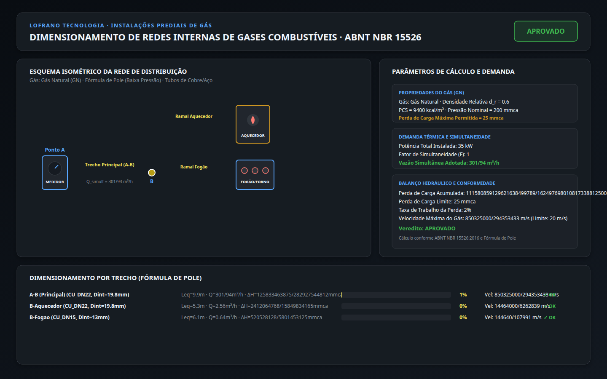

# Dimensionamento de Redes Internas de Gás · ABNT NBR 15526:2016

[](https://github.com/martinlofranodeoliveira/dimensionamento-redes-gas-nbr15526/actions)
[](https://www.python.org/downloads/)
[](LICENSE)
[-brightgreen.svg)]()
[-orange.svg)]()
[](https://lofranotecnologia.com.br)

Biblioteca determinística e interface de linha de comando (CLI) em Python puro para o dimensionamento, verificação analítica e detalhamento normativo de redes de distribuição interna de gases combustíveis (**Gás Natural - GN** e **Gás Liquefeito de Petróleo - GLP**) em instalações residenciais e comerciais conforme a norma brasileira **ABNT NBR 15526:2012/2016**.



---

## Destaques Técnicos e Princípios de Engenharia

- **Zero Dependências Externas**: Implementação 100% autossuficiente sobre a biblioteca padrão do Python 3.11+ (`fractions`, `math`, `sqlite3`, `zipfile`, `json`, `argparse`).
- **Aritmética Racional Exata**: Banimento completo de números de ponto flutuante (`float`) nos domínios hidráulico, térmico e dimensional. Todas as vazões, perdas de carga, comprimentos equivalentes e velocidades operam com frações exatas (`fractions.Fraction`) e inteiros.
- **Conformidade Normativa Integral (ABNT NBR 15526)**:
  - **Gases Combustíveis Padronizados**: Gás Natural ($d_r = 0{,}60$, $PCS = 9400\text{ kcal/m}^3$, $\Delta P_{\max} \le 25\text{ mmca}$) e Gás Liquefeito de Petróleo em fase vapor ($d_r = 1{,}52$, $PCS = 24000\text{ kcal/m}^3$, $\Delta P_{\max} \le 28\text{ mmca}$).
  - **Fórmula de Pole para Baixa Pressão ($P \le 5\text{ kPa}$)**:
    $$\Delta H = \frac{22222 \cdot d_r \cdot L_{eq} \cdot Q^2}{D^5}$$
    Onde $\Delta H$ é a perda de carga em mmca, $d_r$ é a densidade relativa do gás, $L_{eq}$ é o comprimento total equivalente em metros, $Q$ é a vazão em $\text{m}^3/\text{h}$ e $D$ é o diâmetro interno real em milímetros.
  - **Controle Estrito de Velocidade**: Cálculo da velocidade média do gás ($V = \frac{Q \cdot 10000}{9 \cdot \pi \cdot D^2}$) com verificação do limite normativo de ruído e arraste ($V \le 20\text{ m/s}$, recomendado $\le 15\text{ m/s}$).
  - **Fator de Simultaneidade ($F$)**: Curva empírica decrescente conforme a Tabela A.1 da NBR 15526 para redes com múltiplos aparelhos em serviço simultâneo.
  - **Catálogo de Tubulações e Conexões**: Tubos de cobre rígido Classe A (NBR 13206) e tubos de aço-carbono (NBR 5580) com diâmetros internos exatos e comprimentos equivalentes para joelhos 90°, 45°, tês de passagem direta/lateral e válvulas de esfera.
- **Codecs Canônicos e Proteção RFC 8259**:
  - Rejeição de Byte Order Mark (BOM UTF-8 `\xef\xbb\xbf` e `\ufeff`).
  - Rejeição estrita de floats nativos e chaves duplicadas no JSON.
  - Rejeição de profundidade de aninhamento excessiva (> 32).
- **Exportação Multiformato e Sanitizada**:
  - Relatório técnico tabular formatado em texto 100% pt-BR.
  - Tabela CSV sanitizada contra injeção de fórmulas (`=`, `+`, `-`, `@`, `\t`, `\r`).
  - Painel visual em SVG 1440x900 detalhando o esquema isométrico, medidor, derivações, fogão, aquecedor e barras de taxa.
  - Pacote determinístico ZIP com proteção `os.O_EXCL` e carimbo temporal fixo (`2026-01-01`).
- **Auditor Independente em SQLite**: Módulo `tools/verify_independent.py` em memória que recria a base relacional e as formulações analíticas sem importar o pacote de produção.

---

## Formulação Matemática Normativa

### 1. Conversão Térmica de Aparelhos em Vazão

$$Q = \frac{\text{Potência (kW)} \cdot 860}{PCS} \quad [\text{m}^3/\text{h}]$$

### 2. Perda de Carga em Baixa Pressão (Pole)

$$\Delta H = \frac{22222 \cdot d_r \cdot L_{eq} \cdot Q^2}{D^5} \quad [\text{mmca}]$$

Com $L_{eq} = L_{\text{real}} + \sum (n_i \cdot L_{eq,i})$.

### 3. Velocidade Média do Escoamento

$$V = \frac{Q / 3600}{\frac{\pi \cdot (D/1000)^2}{4}} = \frac{Q \cdot 10000}{9 \cdot \pi \cdot D^2} \quad [\text{m/s}] \le 20\text{ m/s}$$

---

## Instalação

```bash
pip install dimensionamento-redes-gas-nbr15526
```

Ou execute diretamente a partir do código-fonte:

```bash
git clone https://github.com/martinlofranodeoliveira/dimensionamento-redes-gas-nbr15526.git
cd dimensionamento-redes-gas-nbr15526
pip install .
```

---

## Uso via Linha de Comando (CLI)

### Consultar Catálogo de Gases, Aparelhos e Tubos

```bash
redes-gas catalogo --tipo todos
```

### Dimensionar a partir de Arquivo JSON

```bash
redes-gas calcular examples/apartamento_residencial_gn.json
```

Exportando para diferentes formatos:

```bash
# Relatório técnico tabular
redes-gas calcular examples/apartamento_residencial_gn.json -f texto -o relatorio.txt

# JSON canônico estruturado
redes-gas calcular examples/apartamento_residencial_gn.json -f json -o resultado.json

# Tabela CSV com proteção de injeção de fórmulas
redes-gas calcular examples/apartamento_residencial_gn.json -f csv -o trechos.csv

# Painel visual SVG 1440x900
redes-gas calcular examples/apartamento_residencial_gn.json -f svg -o docs/painel.svg

# Pacote determinístico ZIP
redes-gas calcular examples/apartamento_residencial_gn.json -f zip -o pacote.zip
```

---

## Uso via API Python

```python
from fractions import Fraction
from redes_gas_nbr15526 import (
    dimensionar_rede_gas,
    gerar_relatorio_texto,
)

aparelhos = [
    {"identificador": "FOGAO", "tipo_padrao": "fogao_4_bocas", "quantidade": 1},
    {"identificador": "AQUECEDOR", "tipo_padrao": "aquecedor_passagem_20l", "quantidade": 1},
]

trechos = [
    {
        "identificador": "A-B (Principal)",
        "comprimento_real_m": 8,
        "tubulacao_codigo": "CU_DN22",
        "conexoes": {"joelho_90": 2, "te_passagem_direta": 1, "valvula_esfera": 1},
    },
    {
        "identificador": "B-Aquecedor",
        "comprimento_real_m": 3,
        "tubulacao_codigo": "CU_DN22",
        "conexoes": {"joelho_90": 3, "valvula_esfera": 1},
        "vazao_m3_h": Fraction(256, 100),
    },
    {
        "identificador": "B-Fogao",
        "comprimento_real_m": 5,
        "tubulacao_codigo": "CU_DN15",
        "conexoes": {"joelho_90": 2, "valvula_esfera": 1},
        "vazao_m3_h": Fraction(64, 100),
    },
]

resultado = dimensionar_rede_gas(
    tipo_gas="GN",
    aparelhos_entrada=aparelhos,
    trechos_entrada=trechos,
    aplicar_fator_simultaneidade=True,
)

print(f"Status: {resultado.resumo_status}")
print(f"Perda de carga acumulada: {resultado.perda_carga_total_acumulada_mmca} mmca")
print(gerar_relatorio_texto(resultado))
```

---

## Testes e Verificação Independente

```bash
# Executar a suíte de 53 testes unitários
python -m unittest discover -s tests -v

# Executar o verificador independente em SQLite in-memory
python tools/verify_independent.py
```

---

## Licença

Distribuído sob a licença [MIT](LICENSE). Desenvolvido pela [Lofrano Tecnologia](https://lofranotecnologia.com.br).
